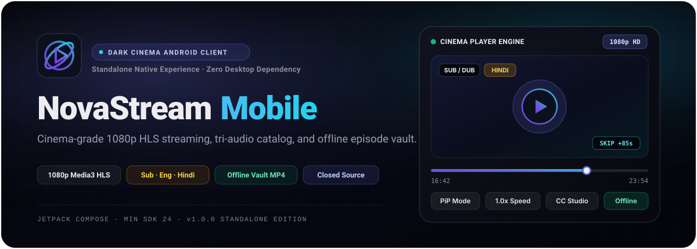
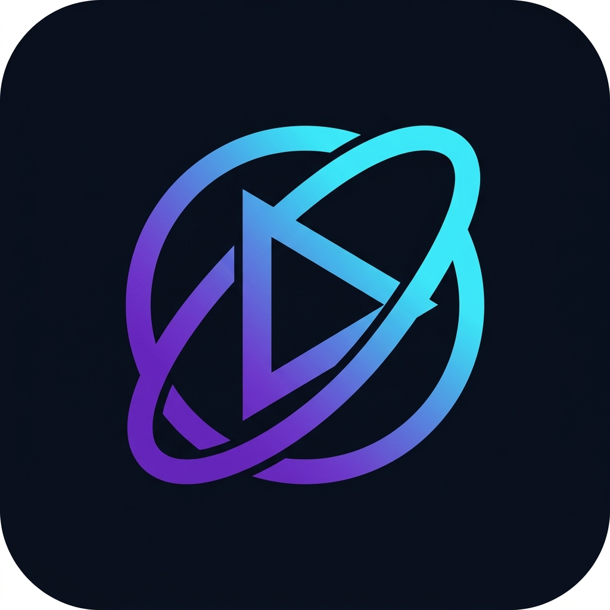
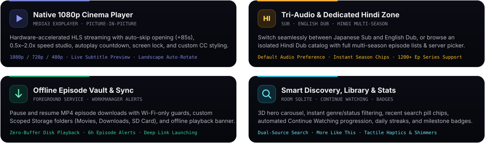
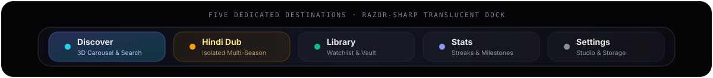
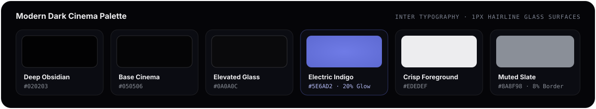

  

<h3>Streamlined. Standalone. Built for Night-Mode Cinema.</h3>

  <strong>NovaStream Mobile</strong> is a 100% standalone native Android anime streaming client built in Kotlin and Jetpack Compose. 
  No companion desktop server, no external proxy required — just crisp 1080p HLS playback, tri-audio discovery, and an offline MP4 vault in your pocket.

  
  
  
  

 

 

## The Experience

 

 

 

## Feature Deep-Dive

<strong>Cinema Player Engine — Built Around Uninterrupted Viewing</strong>

 

- **1080p Native HLS Streaming**: Powered by AndroidX Media3 ExoPlayer with selectable resolution caps (`1080p`, `720p`, `480p`) to match your bandwidth.
- **Sub & English Dub Switching**: Switch audio preferences cleanly between Japanese Sub and English Dub with default audio preference memory.
- **Auto-Skip Opening (`+85s`) & Auto-Play Next**: Floating quick-skip action during openings plus a sleek countdown overlay near episode completion.
- **Custom Subtitle Studio**: Live-preview subtitle customization controls for comfortable late-night readability.
- **Full Mobile Ergonomics**: Picture-in-Picture (`PiP`) mode, `0.5x`–`2.0x` playback speed selector sheet, customizable seek intervals (`5s`–`30s`), screen touch lock, and landscape fullscreen toggle.

<strong>Isolated Hindi Dub Zone — Zero Interference With Main Feed</strong>

 

- **Dedicated Navigation Tab**: Lives cleanly alongside the main Discover experience so Hindi Dub browsing stays uncluttered and separate.
- **Multi-Season Support**: Built to handle both compact seasonal series and massive multi-season epics with season pills and full episode lists.
- **Isolated Search & Playback**: Dedicated catalog search and server switching without polluting Sub/Dub history or stream defaults.

<strong>Offline Vault & Background Sync — Ready Without Signal</strong>

 

- **Foreground Download Service**: Persistent notification progress while downloading episodes in the background.
- **Pause & Resume Reliability**: Byte-range resumable downloads preserve partial progress cleanly so interrupted downloads pick up right where they left off.
- **Scoped Storage Folder Picker**: Choose between App Sandbox, `Movies`, `Downloads`, or External SD Card with a live free-space storage meter and Wi-Fi-only download guard.
- **Offline Network Banner**: Automatically detects offline state and surfaces a one-tap shortcut straight to your downloaded episodes.
- **Background Episode Alerts & Deep Links**: Periodic 6-hour WorkManager sync checks active watchlist series for new releases and opens titles directly via `novastream://anime/{id}`.

<strong>Discovery, Library Vault & Watch Analytics</strong>

 

- **3D Carousel & Dual-Source Search**: Interactive parallax hero carousel paired with instant debounced search, recent search pill chips, genre/status filters, and `"More Like This"` recommendations.
- **Continue Watching & Episode Completion**: Automatic resume timestamps, range pagination chips (`1–100`, `101–200`, ...) for 1,000+ episode series, and one-tap watched markers.
- **Unified Library**: Clean tabs for **Watchlist** (`Watching`, `Plan to Watch`, `Completed`), **Downloads**, and **Watch History**.
- **Personal Stats**: Daily watch streaks, total time watched, episode counters, and achievement milestones.

 

 

## Visual Language & Architecture

 

| Layer | Technology | Role in NovaStream Mobile |
| :--- | :--- | :--- |
| **UI & Motion** | Kotlin · Jetpack Compose · Material 3 | Declarative Dark Cinema layouts, tactile haptics, spring transitions, and shimmer states |
| **Media Engine** | AndroidX Media3 ExoPlayer & HLS | Smooth adaptive HLS streaming, offline MP4 playback, speed control, and Picture-in-Picture |
| **Local Storage** | Room SQLite · KSP · DataStore | Instant offline watchlist, episode completion tracking, watch history, and user preferences |
| **Background & Media** | WorkManager · Coil · Android Palette | 6-hour new-episode alerts, foreground downloads, image caching, and adaptive color extraction |
| **Compatibility** | Min SDK 24 · Target SDK 36 | Runs on Android 7.0 Nougat through modern Android releases with Scoped Storage compliance |

 

 

## Availability & Proprietary Notice

> **Closed-Source Software — All Rights Reserved**
>
> **NovaStream Mobile** is private, proprietary software created by [**Whitedevil964**](https://github.com/Whitedevil964).  
> This repository serves strictly as the **public showcase, feature overview, and release announcement hub** for the application. Source code, scraping internals, and build pipelines are intentionally not open-sourced or distributed here.
>
> - **Current Release Milestone**: `v1.0.0 (Standalone Edition)`
> - **Bug Reports & Feedback**: Use [GitHub Issues](https://github.com/Whitedevil964/Nova-Stream-Mobile/issues) for feature requests or UI feedback.

 

  Crafted with a Dark Cinema obsession for Android · Copyright © Whitedevil964

